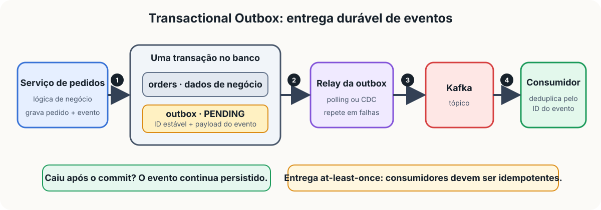
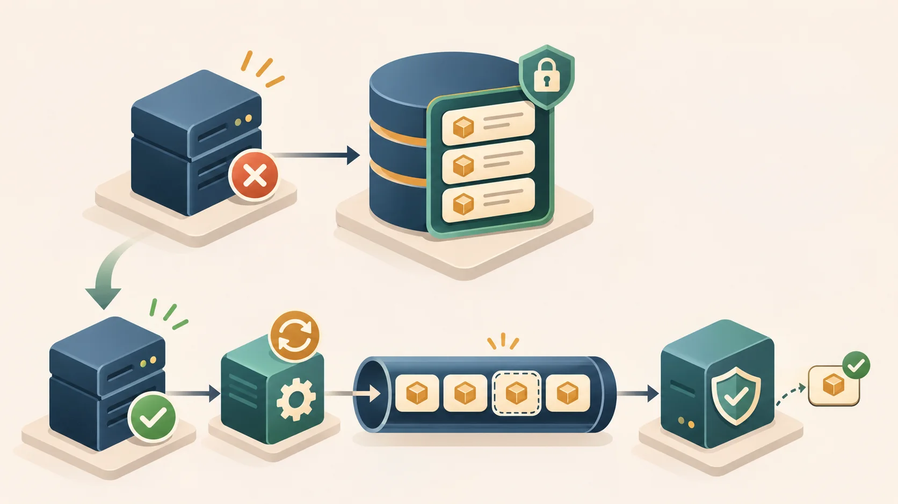

Imagine um serviço de pedidos que salva um pedido em um banco relacional e depois publica `OrderCreated` no Kafka. Se o commit no banco funcionar, mas o processo cair antes de o Kafka receber o evento, o pedido existe, mas os outros serviços nunca ficam sabendo. Inverter a ordem das operações só muda a falha: o Kafka pode receber um evento de uma transação que depois sofre rollback.

Esse é o **problema do dual write**. Em geral, uma transação do banco não consegue incluir a publicação no Kafka, que é um sistema separado, no mesmo commit atômico. O padrão transactional outbox contorna essa lacuna salvando a alteração de negócio e o evento a publicar em uma única transação do banco.



## Grave a alteração e o evento juntos

Outbox é uma tabela no mesmo banco de dados dos dados de negócio. Em uma única transação, a aplicação insere ou atualiza o pedido e grava uma linha de evento:

```sql
BEGIN;

INSERT INTO orders (id, status, total)
VALUES (:order_id, 'CREATED', :total);

INSERT INTO outbox (id, aggregate_type, aggregate_id, event_type, payload, created_at)
VALUES (:event_id, 'Order', :order_id, 'OrderCreated', :payload, now());

COMMIT;
```

A linha da outbox deve ter um ID de evento único e estável, identificador do agregado, tipo de evento, payload (ou uma referência para montá-lo) e os metadados necessários para roteamento e observabilidade. Defina o contrato do payload com cuidado: publicar a entidade inteira do banco pode expor campos internos e dificultar mudanças futuras no schema.

Se a transação sofrer rollback, nem o pedido nem seu evento são gravados. Se ela fizer commit, os dois ficam persistidos. Essa é a garantia central: a aplicação deixa de fazer uma gravação no banco e uma publicação no Kafka como duas etapas independentes no fluxo da requisição.

## Publique usando um relay

Um processo separado move os eventos confirmados da outbox para o Kafka. Há duas abordagens comuns:

1. **Publisher por polling:** consulta linhas pendentes, publica e depois marca como enviadas. Use mecanismos seguros de reserva ou lock (como lease ou `FOR UPDATE SKIP LOCKED`, quando disponível) para que vários workers não selecionem continuamente o mesmo trabalho. Crie índices compatíveis com a consulta de reserva.
2. **Change data capture (CDC):** lê as mudanças confirmadas no log de transações do banco e as roteia para o Kafka, muitas vezes com um conector como Debezium. Isso evita consultar a tabela repetidamente, mas exige operar o conector e a retenção do log.

Escolha de acordo com volume, latência, experiência operacional e banco utilizado. Em ambos os casos, o relay deve repetir falhas transitórias com backoff, expor métricas de atraso e falhas e permitir inspecionar e recuperar eventos problemáticos. Defina retenção ou limpeza para a outbox não crescer indefinidamente.

## Projete para lidar com duplicatas

A outbox evita que o evento se perca entre o commit do banco e a decisão de publicá-lo. Ela **não** garante entrega exatamente uma vez. Considere esta sequência:

1. O relay publica o evento e o Kafka confirma o recebimento.
2. O relay cai antes de registrar que o evento foi enviado.
3. Depois de reiniciar, ele publica o mesmo evento novamente.

Isso é um resultado normal de entrega at-least-once (pelo menos uma vez). Torne os consumidores idempotentes: persista os IDs de eventos processados ou faça com que a operação resultante possa ser repetida sem efeitos adicionais. Quando o consumidor atualiza seu próprio banco, registre o ID e aplique a alteração de negócio na mesma transação local. A idempotência do producer Kafka pode ajudar com retries dentro de uma sessão do producer, mas não combina atomicamente o commit de um banco relacional com a publicação no Kafka nem substitui a deduplicação no consumidor.



## Preserve a ordem quando necessário

Se os eventos de um pedido precisam ser observados em sequência, publique usando o ID do pedido como chave Kafka, para que os eventos sejam enviados à mesma partição. O relay também precisa preservar a ordem pretendida por pedido ao reservar e publicar as linhas. Garantir uma ordem global custa mais e raramente é necessário. Inclua uma versão ou sequência do agregado quando o consumidor precisar detectar atualizações antigas ou fora de ordem.

## Uma estrutura de implementação com Spring Boot

No Spring Boot, mantenha a criação da alteração de domínio e do registro da outbox na mesma transação do service:

```java
@Transactional
public Order createOrder(CreateOrder command) {
    Order order = orderRepository.save(Order.create(command));
    outboxRepository.save(OutboxEvent.orderCreated(order));
    return order;
}
```

O código só é seguro se os dois repositórios usarem o mesmo banco transacional e o mesmo transaction manager. Publicar no Kafka dentro de um método `@Transactional` não cria, por si só, uma única transação atômica entre banco e broker. Um publisher agendado ou um conector CDC pode cuidar da entrega separadamente. Mantenha a publicação fora da transação que cria o pedido e use a outbox como transferência durável.

Em uma implementação por polling, defina explicitamente a máquina de estados (por exemplo `PENDING`, `PROCESSING` com lease, `SENT` e, se necessário, `FAILED`), além dos limites de retry e das regras de recuperação. Use lotes limitados, evite manter locks do banco enquanto espera pelo Kafka e faça a lease expirar para recuperar o trabalho após a queda de um worker. O SQL exato e o comportamento transacional dependem do banco e da configuração do ORM.

## Quando usar — e quais são os custos

A outbox é útil quando uma alteração confirmada de negócio precisa gerar um evento de integração com confiabilidade, especialmente entre serviços. Ela adiciona uma tabela, um relay, monitoramento, retries, retenção e tratamento de duplicatas. Para uma notificação best-effort de baixo impacto, essa complexidade talvez não se justifique. Para eventos importantes, o padrão deixa o comportamento em caso de falha explícito e recuperável.

O padrão não é um botão mágico de “exactly once”. Seu contrato prático é: **o estado de negócio e a intenção de publicar são confirmados juntos; a publicação pode ser repetida; os consumidores toleram duplicatas.** Essa é uma base bem mais confiável para fluxos com Spring Boot e Kafka.
