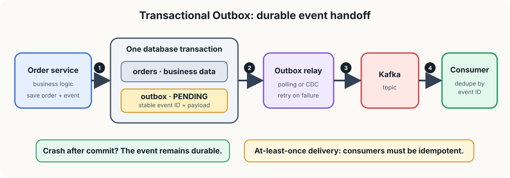
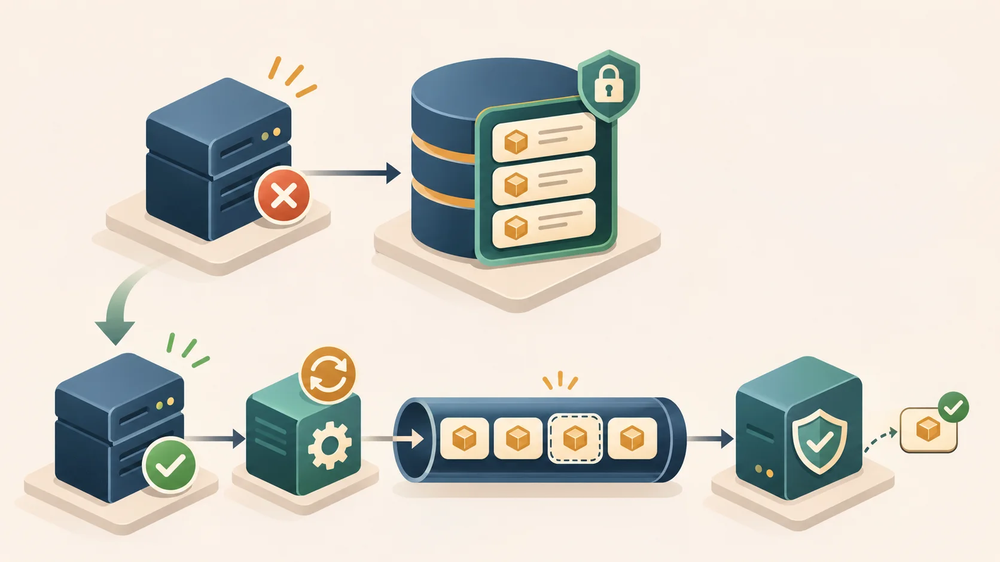

Imagine an order service that saves an order to a relational database and then publishes `OrderCreated` to Kafka. If the database commit succeeds but the process crashes before Kafka receives the event, the order exists but downstream services never hear about it. Reversing the order of those operations only changes the failure: Kafka may receive an event for a transaction that later rolls back.

This is the **dual-write problem**. A database transaction cannot normally make a separate Kafka publish part of the same atomic commit. The transactional outbox pattern avoids that gap by storing the business change and the event to be published in one database transaction.



## Write the change and event together

An outbox is a table in the same database as the business data. In one transaction, the application inserts or updates the order and inserts an event row:

```sql
BEGIN;

INSERT INTO orders (id, status, total)
VALUES (:order_id, 'CREATED', :total);

INSERT INTO outbox (id, aggregate_type, aggregate_id, event_type, payload, created_at)
VALUES (:event_id, 'Order', :order_id, 'OrderCreated', :payload, now());

COMMIT;
```

The outbox row should have a stable unique event ID, an aggregate identifier, an event type, a payload (or a reference from which one can be built), and the metadata needed for routing and observability. Keep the payload contract intentional: publishing an entire database entity can expose internal fields and make future schema changes harder.

If the transaction rolls back, neither the order nor its event is committed. If it commits, both are durable. This is the key guarantee: the application no longer has to perform a database write and a Kafka write as two independent steps in the request path.

## Publish with a relay

A separate process moves committed outbox events to Kafka. There are two common approaches:

1. **Polling publisher:** query rows that are still pending, publish them, then mark them sent. Use safe claiming or locking (for example, a lease or `FOR UPDATE SKIP LOCKED`, where supported) so multiple workers do not continuously select the same work. Add indexes that match the claim query.
2. **Change data capture (CDC):** read committed outbox changes from the database transaction log and route them to Kafka, often with a connector such as Debezium. This avoids repeatedly polling the table, but introduces connector and log-retention operations.

Choose based on throughput, latency, operational skills, and the database you run. Either way, the relay should retry transient failures with backoff, expose lag and failure metrics, and provide a way to inspect and recover poison events. Define a retention or cleanup policy so the outbox does not grow forever.

## Design for duplicates

The outbox prevents an event from being lost between the database commit and the decision to publish. It does **not** make delivery exactly once. Consider this sequence:

1. The relay publishes an event and Kafka acknowledges it.
2. The relay crashes before recording that the event was sent.
3. After restart, it publishes the same event again.

This is a normal at-least-once delivery outcome. Make consumers idempotent: persist processed event IDs, or make the resulting operation naturally safe to repeat. When the consumer updates its own database, record the event ID and apply the business change in the same local transaction. Kafka producer idempotence can help with retries from a producer session, but it does not atomically combine a relational database commit with the Kafka publish, nor replace consumer-side deduplication.



## Preserve ordering where it matters

If events for one order must be observed in sequence, publish them with the order ID as the Kafka key so they are routed to the same partition. The relay must also preserve the intended per-order order when claiming and publishing rows. A global ordering guarantee is more expensive and is rarely needed. Include an aggregate version or sequence when consumers need to detect stale or out-of-order updates.

## A Spring Boot implementation shape

In Spring Boot, keep creation of the domain change and outbox record in the same service-layer transaction:

```java
@Transactional
public Order createOrder(CreateOrder command) {
    Order order = orderRepository.save(Order.create(command));
    outboxRepository.save(OutboxEvent.orderCreated(order));
    return order;
}
```

The code above is only safe if both repositories use the same transactional database and transaction manager. Publishing to Kafka from an `@Transactional` method does not by itself create a single atomic transaction across the database and broker. A scheduled publisher or CDC connector can handle delivery separately. Keep publishing outside the transaction that creates the order, and treat the outbox as the durable handoff.

For a polling implementation, define the state machine explicitly (for example `PENDING`, `PROCESSING` with a lease, `SENT`, and possibly `FAILED`), plus retry limits and recovery rules. Use bounded batches, avoid holding database locks while waiting on Kafka, and make lease expiry recover work after worker crashes. Exact SQL and transaction behavior depend on the database and ORM configuration.

## When to use it—and its costs

The outbox is useful when a committed business change must reliably produce an integration event, especially across service boundaries. It adds a table, a relay, monitoring, retries, retention, and duplicate handling. For a low-consequence best-effort notification, that complexity may not be justified. For important events, it makes failure behavior explicit and recoverable.

The pattern is not a magic “exactly once” switch. Its practical contract is: **business state and intent to publish commit together; publication is retried; consumers tolerate duplicates.** That is a much more reliable foundation for Spring Boot and Kafka workflows.
