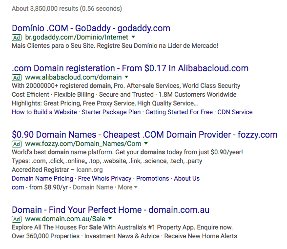

*Read this post in English: [Launch a Side Project Online: A Low-Cost Hosting Setup](/blog/how-to-put-your-side-project-online-with-less-than-1-dollar).* 

Se você gosta de experimentar linguagens e frameworks, talvez tenha um projeto pessoal esperando para ser publicado. Falta de tempo e motivação pode atrapalhar, mas o custo também costuma ser uma preocupação.

Este é o conjunto de serviços de baixo custo que usei em 2020 para colocar uma aplicação pequena no ar. Planos e ofertas gratuitas mudam; considere os preços abaixo como um registro histórico e confira as condições atuais de cada provedor antes de contratar.

## O que usei em 2020

- Um domínio `.com` (ou outro domínio adequado ao projeto).
- Uma VPS Linux da [DigitalOcean](https://m.do.co/c/a35e5b64be59). O plano que usei em 2020 oferecia 1 vCPU, 1 GB de memória, SSD de 25 GB e 1 TB de transferência.
- Um serviço para envio de e-mails, acessado por este [link de cadastro histórico](http://eepurl.com/c3xOub).
- Uma [caixa de e-mail no domínio](https://www.zoho.com/workplace/pricing.html?src=zmail); o plano que usei na época informava 5 GB por usuário.
- Um serviço como o [Cloudflare](https://www.cloudflare.com/) para DNS, HTTPS e cache.

Na época, o preço promocional do domínio no primeiro ano era inferior a US$ 1, e créditos cobriam temporariamente a VPS. Depois que os créditos acabavam, o servidor passava a gerar uma cobrança recorrente.

## Como montei a infraestrutura

### 1. Registrar um domínio

Em 2020, procurei ofertas introdutórias para registrar um domínio `.com` e encontrei uma anunciada por US$ 0,90 no primeiro ano. Preços promocionais e valores de renovação variam; compare o custo de renovação antes de comprar:

Depois da compra, fiquei com um domínio `.com` pelo preço promocional.

**Preço promocional histórico do domínio em 2020: US$ 0,90.**

### 2. Criar um servidor

Usei uma VPS da DigitalOcean. O plano e o preço citados aqui refletem as opções que encontrei em 2020; confira os valores atuais antes de escolher um servidor.

Na época, o plano custava US$ 5 por mês e incluía:

- 1 GB de memória
- 1 vCPU
- 25 GB de armazenamento SSD
- 1 TB de transferência

A oferta de indicação vinculada ao artigo original concedia US$ 100 em créditos promocionais por dois meses. Ofertas mudam e podem não estar disponíveis para todas as contas ou regiões.

Depois de criar a conta, criei um Droplet no painel, escolhendo um plano, uma região e uma distribuição Linux.

Em seguida, adicionei o domínio ao DNS e apontei os registros para o endereço IP do Droplet. Se usar os servidores DNS do provedor, copie os endereços exibidos no painel e configure-os no registrador do domínio. A propagação das mudanças pode levar algum tempo.

Quando o DNS se propaga, o domínio passa a resolver para o servidor. Os US$ 0,90 cobriam apenas o preço promocional do domínio no primeiro ano; a VPS tinha uma cobrança recorrente, compensada temporariamente pelos créditos.

**Preço histórico do servidor em 2020: US$ 5 por mês.**

### 3. Configurar o envio de e-mails

Muitas aplicações precisam enviar e-mails para confirmar contas ou avisar sobre eventos. Nesta configuração de 2020, usei o [Mailchimp](http://eepurl.com/c3xOub). Confira os planos e limites de envio atuais antes de depender desse serviço.

Na época, o plano anunciava até 12 mil e-mails por mês, com limite de 250 por hora. Esses limites históricos podem ter mudado; confirme as cotas atuais e as regras de uso aceitável com o provedor.

A configuração envolvia criar uma conta e adicionar credenciais SMTP à aplicação. Siga as instruções atuais do provedor e armazene credenciais como segredos.

**Plano usado em 2020: faixa gratuita.**

### 4. Criar uma caixa de e-mail no domínio

Para ter uma caixa de entrada no domínio, usei o [Zoho Mail](https://www.zoho.com/workplace/pricing.html?src=zmail). O plano gratuito, o armazenamento e os limites de domínios podem ter mudado; confira os detalhes atuais antes de contar com eles.

**Plano usado em 2020: faixa gratuita.**

### 5. Configurar HTTPS

O HTTPS protege o tráfego entre as pessoas visitantes e o site. Usei o [Cloudflare](https://www.cloudflare.com/) para TLS e cache. Recursos e limites dos planos podem mudar; consulte a [apresentação atual do produto](https://www.cloudflare.com/overview/).

Depois, deleguei o DNS ao Cloudflare e configurei os registros e ajustes de TLS necessários. Siga as instruções atuais do registrador e do Cloudflare: etapas do painel e configurações padrão podem mudar.

**Plano usado em 2020: faixa gratuita.**

## Quanto essa configuração custava na prática

A infraestrutura reunia vários serviços separados. Na época, ela oferecia:

- Um domínio `.com`.
- Um servidor com 1 GB de memória, 1 vCPU e SSD de 25 GB.
- Uma aplicação servida por HTTPS, com cache configurado.
- Um serviço de envio de e-mails e uma caixa de entrada no domínio.

O domínio custou US$ 0,90 no período promocional inicial, enquanto créditos de hospedagem cobriram o servidor por tempo limitado. Depois, havia custos recorrentes. Antes de publicar um projeto, estime renovações e despesas contínuas, não apenas o preço inicial.

Antes de adotar uma infraestrutura parecida hoje, compare os custos de renovação, os limites de envio e de caixa postal, os backups, o firewall, os controles de acesso e o trabalho de operação de uma VPS. Este artigo documenta uma alternativa histórica de baixo custo; não afirma que os mesmos provedores ou preços ainda sejam a melhor opção.

Se for lançar um projeto hoje, confirme preços e limites diretamente com os provedores antes de contratar.
