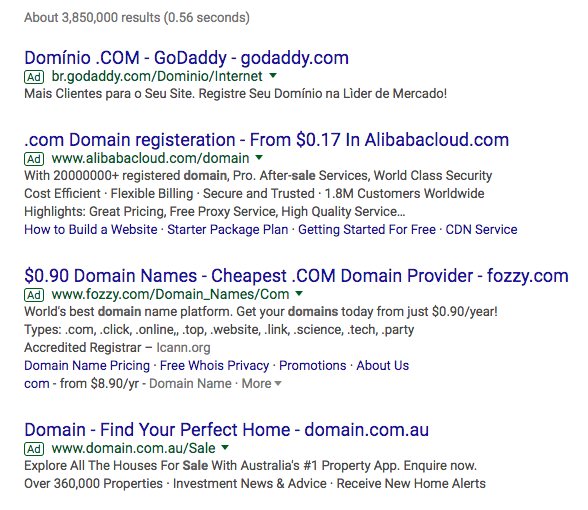

If you enjoy building with new languages and frameworks, you may have a side project waiting to go live. Time and motivation can get in the way, but cost is another common concern.

This is the low-cost setup I used in 2020 to get a small application online. Provider plans and free tiers change, so treat the prices below as a historical example and check each provider’s current terms before signing up.

This is the proposed setup:

- A [.com](https://www.google.com/search?q=.com+domains+sale&oq=.com+domains+sale&gs_l=psy-ab.3..0i22i30k1l4.933.1276.0.1422.5.4.0.0.0.0.229.229.2-1.1.0....0...1.1.64.psy-ab..4.1.227.L1LdrHkPymY) domain of your choice
- A [DigitalOcean](https://m.do.co/c/a35e5b64be59) VPS using Linux (Distro of your choice) with 1 vCPU, 1GB of memory, 25GB SSD and 1TB of transfer.
- A [solution](http://eepurl.com/c3xOub) that helps you sending emails
- A [mailserver](https://www.zoho.com/workplace/pricing.html?src=zmail) with 5GB of space per user, 10 users max.
- A [service](https://www.cloudflare.com/) that provides HTTP (SSL) and cache to your application

At the time, the initial domain cost was under $1, while promotional credit covered the server for a limited period.

## Show me the money!

### First step: Domain Purchase

In 2020, I searched for introductory .com registration offers and found one advertised for $0.90 for the first year. Promotional prices and renewal rates vary, so compare the full renewal cost before buying:

After checkout, I had a .com domain for the promotional price.

**Current cost : $0.90**

### Second step: The Server

Have you ever heard about [DigitalOcean](https://m.do.co/c/a35e5b64be59)? 

I used a DigitalOcean virtual private server. The article’s linked plan and price reflect the options I saw in 2020; check the provider’s current pricing before choosing a server.

With only $5 per month, you can have

- 1GB Memory
- 1 vCPU
- 25GB SSD Disk
- 1TB Transfer

The referral offer linked in the original article provided $100 in promotional credits for two months at the time. Offers change and may not be available to every account or region.

After creating an account using the link above, you can create an account and from your control panel, just get a droplet choosing your plan, region and distro.

After creating your droplet, go to the DNS menu and add your domain, putting your droplet's IP.

Copy the 3 nameservers (NS1.digitalocean.com ...) and change on your domain control panel.

Wait a little for the DNS to reflect the changes and Done! You have a domain and a server to run your application! And we spent only ~~$5.90~~ $0.90!

**Current cost : $0.90**

### Third step: Getting an e-mail service

Many applications need to send email, whether for account verification or notifications. In this 2020 setup, I used [Mailchimp](http://eepurl.com/c3xOub). Check the provider’s current plans and sending limits before relying on this option.

Using the service, you can send 12k e-mails trough SMTP per month, or 250 per hour! **FOR FREE!**

MailChimp is very simple, you create an account and it's almost ready.

**Current cost : $0.90**

### Fourth step: Getting a mailbox

For an inbox on your domain, I used [Zoho Mail](https://www.zoho.com/workplace/pricing.html?src=zmail). Its free plan, storage, and domain limits may have changed; check the current plan details before relying on them.

**Current cost : $0.90**

### Fifth step: Getting SSL (https://...)

HTTPS protects traffic between visitors and your site. I used [Cloudflare](https://www.cloudflare.com/) for TLS and caching. Its features and plan limits can change; see the current [product overview](https://www.cloudflare.com/overview/).

After that you need to change your NS servers to cloudflare and some further settings, but everything is explained on each service website.

**Current cost : $0.90**

### Conclusion

Well, it took some time, but after everything you have:

- A .com domain
- A server with 1GB, 1 vCPU and 25GB SSD
- A web application running over HTTPS(SSL) with cache.
- 2 e-mail servers, 1 for SMTP and other for your inbox.

The domain’s initial promotional price was $0.90, while hosting credit covered the server for a limited period. Recurring costs applied after that. Estimate renewal and ongoing service costs—not just signup prices—before launching.

Have fun!
