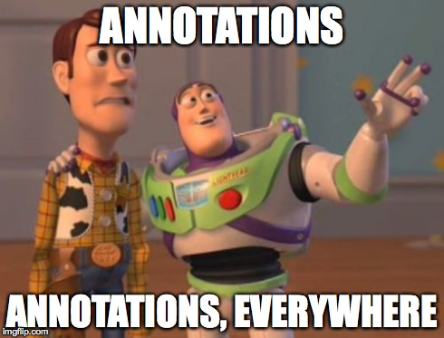

Have you spent time writing—or generating in an IDE—the same Java getters, setters, constructors, and utility methods? A simple data class can require getters, setters, constructors, toString, equals, and hashCode.

Languages such as Kotlin and Scala reduce some of this boilerplate. Java developers can also use Project Lombok, which generates common methods from annotations.

## What is Project Lombok?
Lombok describes the library this way:

> Project Lombok is a Java library that integrates with editors and build tools to generate common code from annotations.

(Paraphrased from the [Project Lombok website](https://projectlombok.org/).)

Lombok uses annotations and generates code during compilation. This can keep source files shorter, though teams should weigh that convenience against the extra IDE and build configuration.



To use Lombok comfortably, configure annotation processing and IDE support for the tools your project uses. The project’s build configuration remains the source of truth; follow the current [Lombok setup guide](https://projectlombok.org/setup/).

- Check [here](https://projectlombok.org/setup/eclipse) for the instructions for eclipse
- Check [here](https://plugins.jetbrains.com/plugin/6317-lombok) for the plugin for IntelliJ
- Check [here](https://projectlombok.org/setup/netbeans) for Netbeans (Please make a favor to yourself and migrate to [IntelliJ Community](https://www.jetbrains.com/idea/download))

## Getters, Setters, toString, equals and hashCode

Then this:

```java
public class Person{
  private String name;
  private int age;

  public String getName(){
    return name;
  }
  
  public void setName(String name){
    this.name = name;
  }
  
  public int getAge(){
    return age;
  }
  
  public void setAge(int age){
    this.age = age;
  }
  
  @Override
  public boolean equals(Object o) {
    if (this == o) {
      return true;
    }
    if (o == null || getClass() != o.getClass()) {
      return false;
    }
    Person person = (Person) o;
    return name == person.name &&
        age == person.age;
  }

  @Override
  public int hashCode() {
    return Objects.hash(name, age);
  }

  @Override
  public String toString() {
    return "Person{" +
        "name=" + name +
        ", age=" + age +
        '}';
  }
}
```

Will be reduced to only:

```java
@Data
public class Person{
  private String name;
  private int age;
}
```


[@Data](https://projectlombok.org/features/Data) provides you @ToString, @EqualsAndHashCode, @Getter on all fields, @Setter on all non-final fields, and @RequiredArgsConstructor.

## Reduce logging boilerplate

Lombok helps you to log easily with the logging library that you choose for your project. It has support to Log4j, Log4j2, Sl4j, CommonsLog and others.

Check the [@Log](https://projectlombok.org/features/log) page.

## Immutable classes and builders

The [@Value](https://projectlombok.org/features/Value) annotation can make immutable classes more concise:

> `@Value` is the immutable variant of `@Data`: fields are private and final by default, setters are not generated, and Lombok generates methods such as `toString()`, `equals()`, `hashCode()`, getters, and an all-arguments constructor. See the [official `@Value` documentation](https://projectlombok.org/features/Value) for details.

I'll write a post in the future of the pros and cons for Immutable classes in Java, but it's a great POJO pattern and you should [check](https://www.baeldung.com/java-immutable-object) it!

## When Lombok is a good fit

Lombok can make Java data classes and logging setup more concise. Agree on the annotations your team will use and configure every developer’s IDE and build consistently. Spring Initializr can also add Lombok to a generated project.

See the [Project Lombok site](https://projectlombok.org/) and its [feature documentation](https://projectlombok.org/features/all) for details.


Lombok can make Java source code concise, but generated methods are less visible during code review and can depend on IDE/build configuration. Teams should agree on which annotations are acceptable, verify generated behavior, and consider Java records for simple immutable data carriers where they fit.
