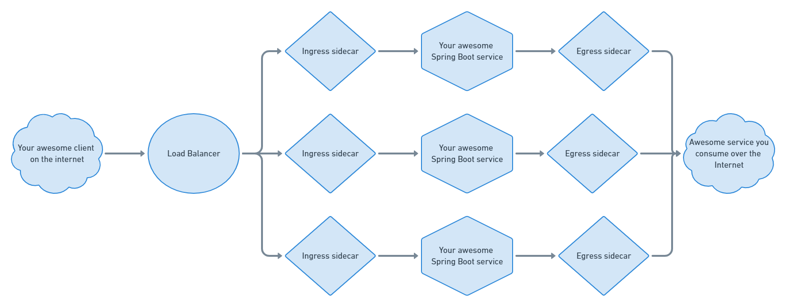
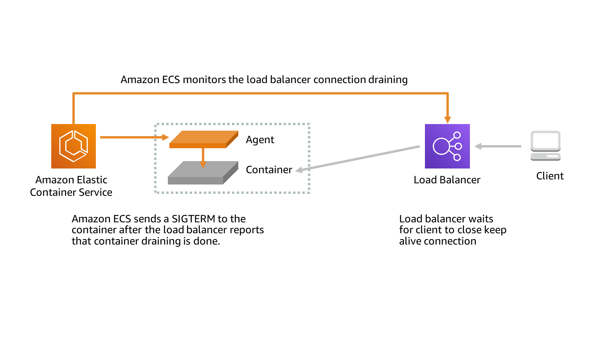

*Read this post in English: [Graceful Shutdown for Spring Boot in Docker and Kubernetes](/blog/spring-boot-docker-orchestrators).* 

Quando um orquestrador interrompe um contêiner, a aplicação normalmente recebe SIGTERM e tem um tempo limitado para concluir o trabalho em andamento antes de ser encerrada à força com SIGKILL. Este artigo mostra como habilitar o encerramento gradual numa aplicação web Spring Boot e por que o prazo de encerramento do orquestrador precisa permitir tempo suficiente para a aplicação parar.

## Por que o encerramento gradual importa

Um fluxo comum de requisição inclui um balanceador de carga, um orquestrador e uma ou mais instâncias Spring Boot:



Durante uma implantação ou redução de escala, o balanceador e o orquestrador precisam parar de enviar novo trabalho para uma instância enquanto as requisições existentes terminam:



Sem coordenar a drenagem de conexões com o encerramento gradual, requisições podem ser interrompidas e clientes podem receber erros. A sequência exata depende do balanceador, orquestrador, servidor e configuração da aplicação.

## Habilitar o encerramento gradual

Nas versões do Spring Boot que oferecem suporte, habilite a opção em `application.properties` ou `application.yml`:

```properties
server.shutdown=graceful
```

A propriedade foi introduzida no Spring Boot 2.3; confirme se a versão da aplicação oferece suporte.

Ou use YAML:

```yaml
server:
  shutdown: graceful
```

Essa configuração instrui os servidores web compatíveis do Spring Boot a parar de aceitar novas requisições e dar tempo às requisições ativas para terminar. Consulte a referência da sua versão do Spring Boot e do servidor embutido.

Configure em conjunto o timeout de encerramento do ciclo de vida Spring e o prazo de término do contêiner. Reserve tempo para a desativação do balanceador, as requisições ativas e o encerramento do processo; os valores corretos dependem do orquestrador e da aplicação. O comportamento exato depende do servidor e da versão do Spring Boot; consulte a [referência de encerramento gradual do Spring Boot](https://docs.spring.io/spring-boot/reference/web/graceful-shutdown.html).
