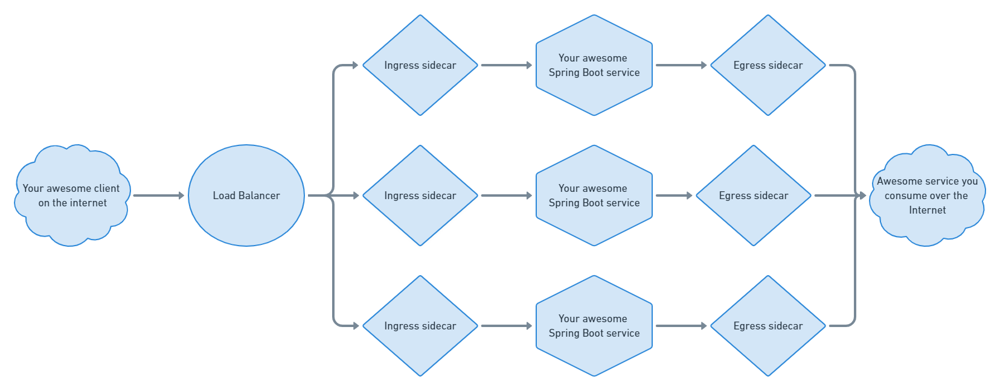
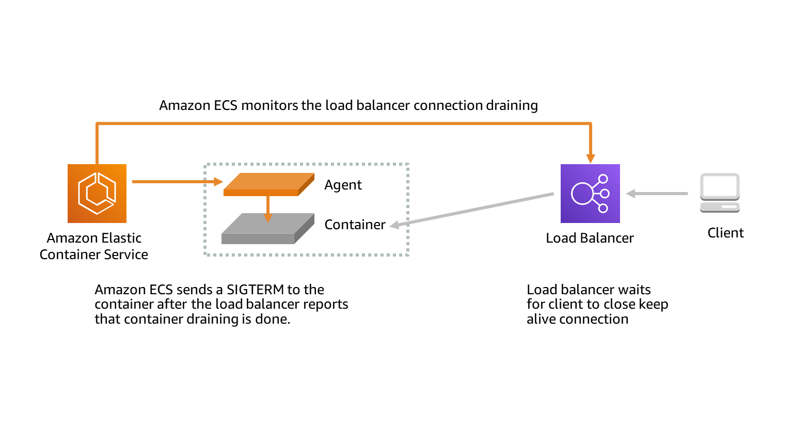

When an orchestrator stops a container, the application usually receives SIGTERM and has a limited time to finish active work before it is forcefully terminated with SIGKILL. This article shows how to enable graceful shutdown for a Spring Boot web application and why the orchestrator’s termination grace period must allow the application enough time to stop.

## Why graceful shutdown matters

A typical request path includes a load balancer, an orchestrator, and one or more Spring Boot instances:



During deployment or scale-in, the load balancer and orchestrator need to stop routing new work to an instance while existing requests finish:



Without coordinated draining and graceful shutdown, requests can be interrupted and clients may see errors. The exact sequence depends on the load balancer, orchestrator, server, and application configuration.

## Enable graceful shutdown

For Spring Boot versions that support graceful shutdown, enable it in `application.properties` or `application.yml`:

```properties
server.shutdown=graceful
```

This property was introduced in Spring Boot 2.3; confirm it is supported by your application version.

Or use YAML:

```yaml
server:
  shutdown: graceful
```

This setting tells supported Spring Boot web servers to stop accepting new requests and give active requests time to complete. Check the reference for your Spring Boot version and embedded server.

Set the Spring lifecycle shutdown timeout and container termination grace period together. Allow time for load-balancer deregistration, active requests, and process shutdown; the correct values depend on the orchestrator and application. The exact behavior depends on the server and Spring Boot version; see the [Spring Boot graceful shutdown reference](https://docs.spring.io/spring-boot/reference/web/graceful-shutdown.html).
