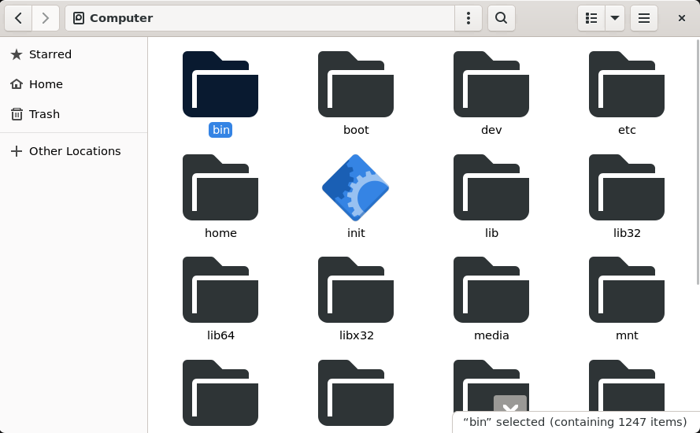
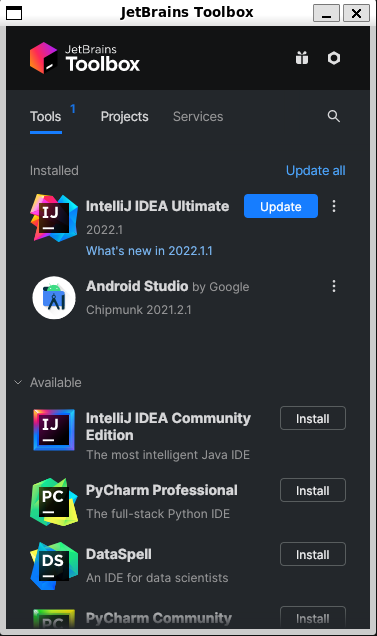

This is a 2022 account of running IntelliJ IDEA inside WSLg after I had trouble importing a Gradle project through my Windows IDE setup. WSL and JetBrains support have changed since then, so check the current [JetBrains WSL development documentation](https://www.jetbrains.com/help/idea/how-to-use-wsl-development-environment-in-product.html) before following these steps.

As I mentioned [here](/blog/why-wsl2-is-so-slow), I'm trying to use WSL for my development setup.

I'm a heavy user of MacOS since 2014 when i bought my first Macbook Pro, but in 2020 I wanted to play some "heavier" games with mouse and keyboard, i ended up selling my current Macbook since i had one from the company that I was working for and I bought a brand new Desktop with Windows.

After a little bit more than 6 years I came back to the blue side of the force (And i don't mean that this is a joke about the random BSODs that Windows gives us from time to time) :D

From previous experiences, I always regret on having dual boot with an Ubuntu and Windows, but in the other side i don't know how to develop anymore without some terminal tools such as brew, sdkman and others.

So, a friend of mine introduced me then the magic world of WSL (Windows Subsystem for Linux) and the capability of running an Ubuntu machine inside Windows without doing the 1000 hacks for making it work inside a Virtualbox image, that sounded AMAZING, almost like magic.

At the time, I ran into slow Gradle imports when IntelliJ on Windows worked with project files and Gradle inside WSL. Keeping the IDE and project tools in one environment was the workaround I chose; it was a personal experience, not a claim about current JetBrains support.

IntelliJ 2022.1 was launched and as a "early adopter", I installed it to check some nice features that i wanted (For example Lombok support to the new records in Java), but at the same time, I have some "pet projects" in Kotlin using gradle, and it became very painfully and slow the indexing of libraries using the Gradle inside WSL (Like, hours to import a project).

I know that Windows Defender has it's fault on this, but at the same time, is somehow impossible to simply turn it off.

## But well, how did i solve this issue?

After some research and pain, a lot of pain, i simply resigned to make it work with IntelliJ inside Windows connecting to the project and Gradle inside WSL and focused on something very nice named [wslg](https://github.com/microsoft/wslg), which is a way to enable WSL to run "visual" applications (X server related scenarios) on WSL, and installing the Jetbrains toolbox inside the WSL instead!

## But how?

### Pre requisites

I'm currently using Windows 11 with the latest wsl, in order to update your WSL, you must run this command in a powershell with administration rights:

```bash
wsl --update
```

Once the command runs, let's restart the WSL distros by using the `wsl --shutdown` command.

### Launch the linux GUI

Now, the wlsg should be already in place, and you can try it by installing nautilus:

```bash
sudo apt install nautilus -y
```

After that, you can try nautilus yourself by typing `nautilus` in the WSL terminal, you should see something like this:



### Now installing the IntelliJ

Even on Mac, i use the [Jetbrains toolbox](https://www.jetbrains.com/toolbox-app/), which is an application where you can manage the Jetbrains applications you want to install and which version, and keeps it updated for you.

So, go to the [toolbox](https://www.jetbrains.com/toolbox-app/) website, download the tar.gz version for linux using `wget` or even from windows.

Paste the .tar.gz file inside the WSL file system and extract it, for example:

```bash
sudo tar -xzf jetbrains-toolbox-1.23.11849.tar.gz -C ~/
```

This will extract it to your user's root folder.

Then, from nautilus, you can simply double click the Jetbrains toolbox and it should appear like this:



If everything went correctly, you will probably be able to see a shortcut to the IntelliJ or Toolbox in your startup menu

### What if the shortcut is not showing up?

In ~/.local/share/applications should have a file jetbrains-idea-ce.desktop

Check out this directory `~/.local/share/applications` there should be a file named `jetbrains-idea-ce.desktop` in it.

```bash
ls ~/.local/share/applications
```

Move the file to /usr/share/applications

```
cd ~/.local/share/applications
sudo cp *.desktop /usr/share/applications
```

