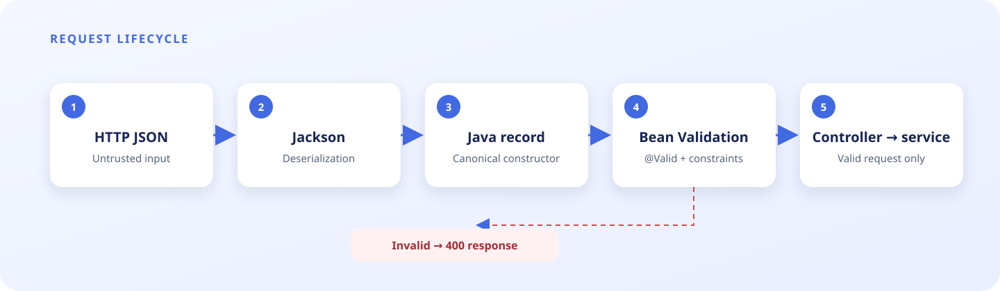
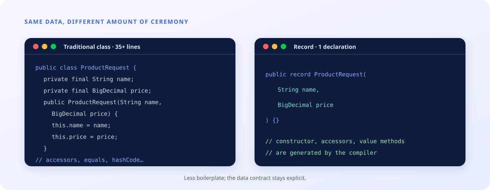
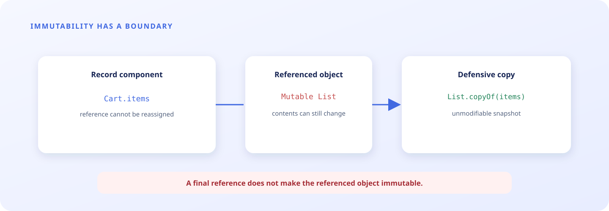

Is it still worth writing Java DTOs with private fields, a no-argument constructor, getters, and setters? For many objects that only carry data, no. A `record` provides a concise way to declare a data type that is immutable by construction, with a canonical constructor, accessors, `equals`, `hashCode`, and `toString` generated by the compiler.

In Spring Boot, records work very well as request and response DTOs. But a concise object is not automatically a well-validated HTTP boundary: validation only happens when it is configured and triggered. This guide follows a request from JSON to the service, reviews the limits of immutability, and explains why a DTO and a JPA entity have different jobs.



## What a record gives you

A record is a final class intended to represent a set of components. When you declare:

```java
public record ProductRequest(String name, BigDecimal price) {}
```

Java generates, among other things, a canonical constructor `ProductRequest(String, BigDecimal)`, the accessors `name()` and `price()`, as well as `equals`, `hashCode`, and `toString`. The components do not get JavaBean getters named `getName()` and `getPrice()`; the idiomatic accessors are `request.name()` and `request.price()`.

This is more than fewer lines. A record's state cannot be reassigned after construction. Its shape is explicit in the declaration, and generated equality compares its components. Records fit when an object's identity is essentially the values it carries.



## Accept and validate a request

Consider an API that creates products. We can declare constraints alongside the DTO components:

```java
import jakarta.validation.constraints.NotBlank;
import jakarta.validation.constraints.NotNull;
import jakarta.validation.constraints.Positive;
import jakarta.validation.constraints.PositiveOrZero;
import java.math.BigDecimal;

public record ProductRequest(
        @NotBlank String name,
        @NotNull @Positive BigDecimal price,
        @PositiveOrZero int stock) {}
```

Each constraint expresses a different rule:

- `@NotBlank` rejects `null`, an empty string, and whitespace-only text.
- `@NotNull` rejects a missing price. `@Positive` accepts `null`, so the two annotations serve complementary purposes.
- `@Positive` accepts only numbers greater than zero. If a zero price is valid, use `@PositiveOrZero`.
- Primitive `int` cannot be `null`. If it matters whether the field was omitted or explicitly set to zero, use `Integer` with a constraint such as `@NotNull`.

In the controller, `@Valid` requests validation of the deserialized body:

```java
@RestController
@RequestMapping("/products")
class ProductController {
    private final ProductService productService;

    ProductController(ProductService productService) {
        this.productService = productService;
    }

    @PostMapping
    @ResponseStatus(HttpStatus.CREATED)
    ProductResponse create(@Valid @RequestBody ProductRequest request) {
        return productService.create(request);
    }
}
```

In a Spring Boot application, put a Bean Validation implementation on the classpath, commonly through `spring-boot-starter-validation` when appropriate for the version in use. Annotations do not perform validation by themselves if no provider is present. With `@Valid` and MVC validation configured, standard request-body violations are reported before the controller method runs, and the application normally responds with `400 Bad Request`.

That means the service does not receive an invalid request through this HTTP flow. It does not make HTTP validation a universal guarantee: internal service calls, message consumers, and jobs do not pass through the controller. Business rules that must hold across every path should also be protected in the domain or service layer.

## The canonical constructor can protect invariants too

Bean Validation constraints are useful for Spring integration, but a record can also check invariants in its compact constructor. The check runs whenever the object is constructed, including outside an HTTP request:

```java
public record Money(BigDecimal amount, Currency currency) {
    public Money {
        Objects.requireNonNull(amount, "amount");
        Objects.requireNonNull(currency, "currency");
        if (amount.scale() > 2) {
            throw new IllegalArgumentException("amount supports at most 2 decimal places");
        }
    }
}
```

The compact constructor makes parameters available for validation; the compiler assigns the components after the block completes. Use it for fundamental invariants of the value itself. For HTTP DTOs, constraints often produce more consistent client-facing messages and integrate naturally with Spring validation. There is no need to duplicate every rule in both places; choose the layer where the rule belongs.

## Validate nested objects

A constraint on an outer record does not automatically traverse its nested objects. To validate a list of items, annotate the component with `@Valid` and validate each relevant property:

```java
public record OrderRequest(
        @NotBlank String customerReference,
        @NotEmpty List<@Valid OrderLineRequest> lines) {}

public record OrderLineRequest(
        @NotBlank String sku,
        @Positive int quantity) {}
```

Here, `@NotEmpty` requires at least one line; `@Valid` requests cascaded validation of each `OrderLineRequest`. This prevents accepting an order with a present list but invalid elements.

## Return useful validation errors

Spring's default behavior may be enough for an internal API. For a public API, a stable format helps clients fix their request. With modern Spring Framework, a `@RestControllerAdvice` can map `MethodArgumentNotValidException` to a consistent response body:

```java
@RestControllerAdvice
class ApiValidationHandler {
    @ExceptionHandler(MethodArgumentNotValidException.class)
    ResponseEntity<ValidationError> handle(MethodArgumentNotValidException ex) {
        var errors = ex.getBindingResult().getFieldErrors().stream()
                .map(error -> new FieldViolation(error.getField(), error.getDefaultMessage()))
                .toList();

        return ResponseEntity.badRequest()
                .body(new ValidationError("Request validation failed", errors));
    }
}

record FieldViolation(String field, String message) {}
record ValidationError(String message, List<FieldViolation> errors) {}
```

The exact exception types and error format can vary by version and configuration, especially when method-parameter validation is involved as well as body validation. Standardize the contract and do not expose internals, class names, or stack traces. For localized messages, configure Bean Validation messages and the application's locale resolution.

## Return a dedicated DTO

The response DTO should represent the public API contract, not necessarily the persisted entity structure:

```java
public record ProductResponse(
        UUID id,
        String name,
        BigDecimal price,
        int stock) {

    static ProductResponse from(Product product) {
        return new ProductResponse(
                product.getId(), product.getName(), product.getPrice(), product.getStock());
    }
}
```

Keeping `ProductRequest`, `ProductResponse`, and `Product` separate lets the input contract, output contract, and persistence model evolve for different reasons. It also prevents accidentally exposing internal fields, lazy relationships, or properties a client should not send or receive.

Returning a JPA entity directly can lead to serialization cycles in bidirectional relationships, lazy queries during serialization, and accidental field exposure. An explicit DTO reduces this coupling and makes the API contract clearer.

## A record is not deep immutability

A record prevents reassigning a component reference, but it does not automatically freeze the referenced object:

```java
public record Cart(List<String> items) {}
```

Code can still mutate the list supplied to `Cart`. If the contract requires a defensive copy:

```java
public record Cart(List<String> items) {
    public Cart {
        items = List.copyOf(items);
    }
}
```

`List.copyOf` creates an unmodifiable list and rejects `null` elements. Consider arrays, maps, and mutable nested objects too. For DTOs Jackson creates from an HTTP body, this matters if the object is shared or retained beyond immediate processing.



## Why not use a record as a JPA entity?

A JPA entity has persistence identity and lifecycle; a record DTO represents values transferred in an operation. These are different roles. The Jakarta Persistence 3.2 specification still requires an entity class not to be `final`, while records are implicitly `final`; the traditional entity model also requires a public or protected no-argument constructor. Therefore, a record is not a portable JPA entity.

Use a conventional entity class with the appropriate mapping, and convert between entity and DTO at the application boundary. Some providers and use cases may offer extensions or support for records as projections and embeddable values; that does not make records lifecycle-managed entities. Check the exact specification and provider before relying on provider-specific behavior.

## When a regular class is a better fit

Choose a regular class when the object has state that changes over time, setters are required by a legacy integration, the class needs to be extended, or project tools and frameworks depend on JavaBean conventions. A class can also make the model clearer when it has many business methods and is more than an aggregate of values.

A record is a good fit when the data shape is stable, construction can receive all components, and value-based equality makes sense. You do not need to convert everything at once: adopt records where they reduce boilerplate without breaking existing contracts.

## Production checklist

- Confirm the Java, Spring Boot, and Jackson versions supported by your project.
- Include a Bean Validation provider and use `@Valid` at the entry point.
- Choose wrappers when `null` or absence differs from zero or false.
- Use `@Valid` on nested components and validate collection elements.
- Keep critical business rules in a layer every execution path crosses.
- Define a stable error format and do not expose internals.
- Return explicit DTOs instead of serializing entities for convenience.
- Make defensive copies when mutable components cross trust boundaries.
- Do not use records as portable JPA entities.

Records remove much of the repetitive code from DTOs without hiding their data shape. With validation triggered at the controller, domain rules in the right layer, and explicit response contracts, they make the HTTP boundary smaller and easier to review. The benefit comes from using the right type for the right role—not from replacing every Java class with a record.

See also the [Portuguese version of this guide](/blog/java-records-spring-boot-dtos-pt). For authoritative details, consult the [Spring MVC validation reference](https://docs.spring.io/spring-framework/reference/web/webmvc/mvc-config/validation.html), the [Jakarta Persistence 3.2 specification](https://jakarta.ee/specifications/persistence/3.2/jakarta-persistence-spec-3.2.html), and the [Java Language Specification on records](https://docs.oracle.com/en/java/javase/26/language/records.html).
