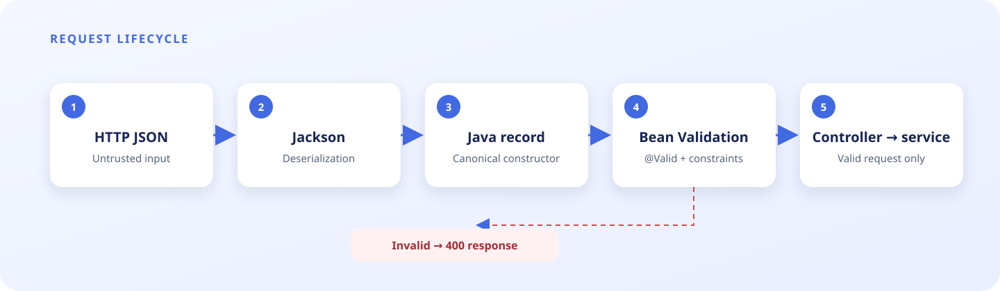
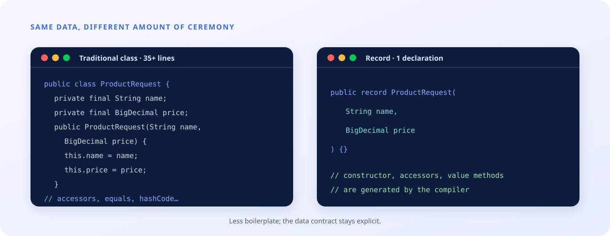
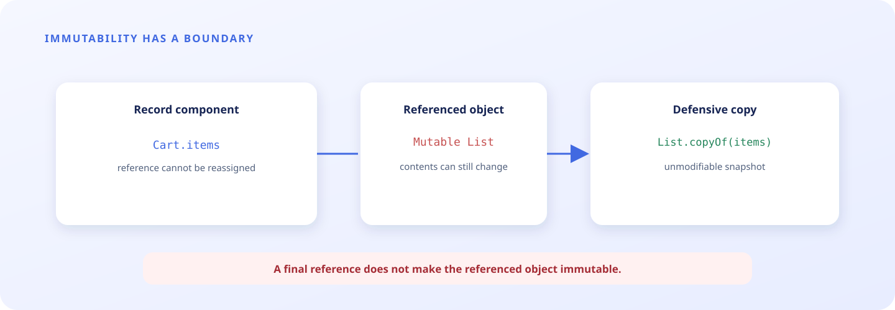

Ainda vale escrever DTOs Java com campos privados, construtor vazio, getters e setters? Para muitos objetos que apenas transportam dados, não. Um `record` oferece uma forma concisa de declarar um tipo de dados imutável por construção, com construtor canônico, acessores, `equals`, `hashCode` e `toString` gerados pelo compilador.

No Spring Boot, records funcionam muito bem como DTOs de requisição e resposta. Mas há uma diferença entre ter um objeto conciso e ter uma fronteira HTTP bem validada: a validação só acontece quando está configurada e acionada. Neste guia, vamos seguir um pedido desde o JSON até o serviço, revisar os limites da imutabilidade e separar DTO de entidade JPA.



## O que um record oferece

Um record é uma classe final destinada a representar um conjunto de componentes. Ao declarar:

```java
public record ProductRequest(String name, BigDecimal price) {}
```

Java gera, entre outras coisas, um construtor canônico `ProductRequest(String, BigDecimal)`, os métodos de acesso `name()` e `price()`, além de `equals`, `hashCode` e `toString`. Os componentes não ganham os getters JavaBean `getName()` e `getPrice()`; o acesso idiomático é `request.name()`.

Isso não é apenas uma redução de linhas. O estado de um record não pode ser reatribuído depois da construção. A forma do objeto fica explícita na declaração, e a igualdade gerada compara seus componentes. Records são adequados quando a identidade do objeto é essencialmente o conjunto de valores que ele carrega.



## Receber e validar uma requisição

Considere uma API que cria produtos. Podemos declarar as restrições junto aos componentes do DTO:

```java
import jakarta.validation.constraints.NotBlank;
import jakarta.validation.constraints.NotNull;
import jakarta.validation.constraints.Positive;
import jakarta.validation.constraints.PositiveOrZero;
import java.math.BigDecimal;

public record ProductRequest(
        @NotBlank String name,
        @NotNull @Positive BigDecimal price,
        @PositiveOrZero int stock) {}
```

Cada restrição expressa uma regra diferente:

- `@NotBlank` rejeita `null`, texto vazio e texto composto só por espaços.
- `@NotNull` rejeita ausência de preço. `@Positive` aceita `null`, então as duas anotações cumprem papéis complementares.
- `@Positive` aceita somente números maiores que zero. Se preço zero for válido, use `@PositiveOrZero`.
- `stock` é um `int` primitivo e não pode ser `null`. Se a distinção entre campo ausente e zero for importante, use `Integer` com uma restrição como `@NotNull`.

No controller, `@Valid` solicita a validação do corpo desserializado:

```java
@RestController
@RequestMapping("/products")
class ProductController {
    private final ProductService productService;

    ProductController(ProductService productService) {
        this.productService = productService;
    }

    @PostMapping
    @ResponseStatus(HttpStatus.CREATED)
    ProductResponse create(@Valid @RequestBody ProductRequest request) {
        return productService.create(request);
    }
}
```

Em uma aplicação Spring Boot, inclua uma implementação de Bean Validation no classpath, normalmente por meio de `spring-boot-starter-validation` quando aplicável à versão usada. Sem o provedor, as anotações não fazem a validação acontecer por conta própria. Com `@Valid` e a infraestrutura MVC configurada, violações padrão no corpo da requisição são reportadas antes da execução do método do controller, e a aplicação normalmente responde com `400 Bad Request`.

Assim, o service não recebe o pedido inválido neste fluxo HTTP. Isso não transforma a validação HTTP em garantia universal: chamadas internas ao serviço, consumidores de mensagens e jobs não passam pelo controller. Regras de negócio que precisam valer em todos os caminhos devem também ser protegidas na camada de domínio ou serviço.

## O construtor canônico também pode proteger invariantes

Restrições Bean Validation são úteis para integração com Spring, mas um record também pode verificar invariantes no construtor compacto. A verificação ocorre sempre que o objeto é construído, inclusive fora de uma requisição HTTP:

```java
public record Money(BigDecimal amount, Currency currency) {
    public Money {
        Objects.requireNonNull(amount, "amount");
        Objects.requireNonNull(currency, "currency");
        if (amount.scale() > 2) {
            throw new IllegalArgumentException("amount supports at most 2 decimal places");
        }
    }
}
```

O construtor compacto deixa os parâmetros disponíveis para validação e o compilador atribui os componentes depois que o bloco termina. Use esse recurso para invariantes fundamentais do próprio valor. Em DTOs HTTP, constraints costumam produzir mensagens mais consistentes para o cliente e se integram naturalmente à validação do Spring. Não é necessário duplicar toda regra nos dois lugares; escolha onde a regra pertence.

## Validar objetos aninhados

Uma restrição no record externo não percorre automaticamente seus objetos internos. Para validar uma lista de itens, anote o componente com `@Valid` e também valide cada propriedade relevante:

```java
public record OrderRequest(
        @NotBlank String customerReference,
        @NotEmpty List<@Valid OrderLineRequest> lines) {}

public record OrderLineRequest(
        @NotBlank String sku,
        @Positive int quantity) {}
```

Aqui, `@NotEmpty` exige pelo menos uma linha; `@Valid` pede validação em cascata de cada `OrderLineRequest`. Esse detalhe evita aceitar pedidos que têm uma lista presente, mas elementos inválidos.

## Responder a erros de forma útil

O comportamento padrão do Spring pode ser suficiente para uma API interna. Para uma API pública, um formato estável ajuda clientes a corrigir o pedido. Com Spring Framework moderno, um `@RestControllerAdvice` pode mapear `MethodArgumentNotValidException` para um corpo consistente:

```java
@RestControllerAdvice
class ApiValidationHandler {
    @ExceptionHandler(MethodArgumentNotValidException.class)
    ResponseEntity<ValidationError> handle(MethodArgumentNotValidException ex) {
        var errors = ex.getBindingResult().getFieldErrors().stream()
                .map(error -> new FieldViolation(error.getField(), error.getDefaultMessage()))
                .toList();

        return ResponseEntity.badRequest()
                .body(new ValidationError("Request validation failed", errors));
    }
}

record FieldViolation(String field, String message) {}
record ValidationError(String message, List<FieldViolation> errors) {}
```

Os tipos exatos das exceções e o formato de erro podem variar conforme versão e configuração, em especial quando há validação de parâmetros de método além da validação do corpo. Padronize o contrato e não exponha detalhes internos, nomes de classes ou stack traces. Para mensagens localizadas, configure as mensagens Bean Validation e a resolução de locale da aplicação.

## Retornar um DTO próprio

O DTO de saída deve representar o contrato público da API, não necessariamente a estrutura da entidade persistida:

```java
public record ProductResponse(
        UUID id,
        String name,
        BigDecimal price,
        int stock) {

    static ProductResponse from(Product product) {
        return new ProductResponse(
                product.getId(), product.getName(), product.getPrice(), product.getStock());
    }
}
```

Separar `ProductRequest`, `ProductResponse` e `Product` permite que o contrato de entrada, o de saída e o modelo persistente evoluam por razões diferentes. Também evita expor acidentalmente campos internos, relacionamentos lazy ou propriedades que o cliente não deveria enviar nem receber.

Ao devolver entidade JPA diretamente, problemas comuns incluem ciclos de serialização em relacionamentos bidirecionais, consultas lazy disparadas durante a serialização e exposição inadvertida de campos. Um DTO explícito reduz esse acoplamento e deixa mais claro o contrato da API.

## Record não é sinônimo de imutabilidade profunda

Um record impede reatribuir a referência de um componente, mas não congela automaticamente o objeto referenciado:

```java
public record Cart(List<String> items) {}
```

O código ainda pode alterar a lista recebida por `Cart`. Se o contrato exigir uma cópia defensiva:

```java
public record Cart(List<String> items) {
    public Cart {
        items = List.copyOf(items);
    }
}
```

`List.copyOf` cria uma lista não modificável e rejeita elementos `null`. Pense também em arrays, mapas e objetos mutáveis aninhados. Para DTOs que o Jackson cria a partir do corpo HTTP, essa escolha importa se o objeto for compartilhado ou retido além do processamento imediato.



## Por que não usar record como entidade JPA?

Uma entidade JPA tem identidade e ciclo de vida de persistência; um DTO de record representa valores transferidos em uma operação. São papéis diferentes. A especificação Jakarta Persistence 3.2 continua exigindo que uma classe de entidade não seja `final`, e records são implicitamente `final`; o modelo tradicional de entidade também requer construtor sem argumentos público ou protegido. Por isso, record não serve como entidade JPA portátil.

Use uma classe de entidade convencional, com o mapeamento apropriado, e converta entre entidade e DTO na fronteira da aplicação. Alguns provedores e cenários podem oferecer extensões ou suporte a records para projeções e valores embutidos; isso não transforma records em entidades de ciclo de vida persistente. Confira a especificação e o provedor exato antes de depender de comportamento específico.

## Quando uma classe comum é melhor

Escolha uma classe comum quando o objeto tiver estado que muda ao longo do tempo, setters forem exigidos por uma integração legada, a classe precisar ser estendida, ou ferramentas/frameworks do projeto dependerem de convenções JavaBean. Uma classe também pode tornar o modelo mais claro quando há muitos métodos de negócio e o objeto não é apenas um agregado de valores.

Um record é uma boa opção quando a forma do dado é estável, a construção pode receber todos os componentes e a igualdade por valor faz sentido. Não é necessário convertê-los todos de uma vez: adote records onde eles reduzem boilerplate sem contrariar os contratos existentes.

## Checklist para produção

- Confirme a versão do Java, Spring Boot e Jackson suportada no projeto.
- Inclua um provedor Bean Validation e use `@Valid` no ponto de entrada.
- Escolha wrappers quando `null` ou ausência diferirem de zero/false.
- Use `@Valid` em componentes aninhados e valide os elementos da coleção.
- Mantenha regras de negócio críticas na camada que todos os fluxos atravessam.
- Defina um formato de erro estável e não exponha detalhes internos.
- Retorne DTOs explícitos em vez de serializar entidades por conveniência.
- Faça cópias defensivas se componentes mutáveis atravessarem fronteiras de confiança.
- Não use records como entidades JPA portáveis.

Records eliminam muito código repetitivo de DTO sem esconder como os dados são estruturados. Com validação acionada no controller, regras de domínio no lugar correto e contratos de saída explícitos, eles deixam a borda HTTP menor e mais fácil de revisar. O ganho vem de usar o tipo certo para o papel certo — não de substituir cada classe Java por um record.

Veja também a versão [em inglês deste guia](/blog/java-records-spring-boot-dtos-en). Para detalhes oficiais, consulte a [referência de validação do Spring MVC](https://docs.spring.io/spring-framework/reference/web/webmvc/mvc-config/validation.html), a [especificação Jakarta Persistence 3.2](https://jakarta.ee/specifications/persistence/3.2/jakarta-persistence-spec-3.2.html) e a [especificação da linguagem Java sobre records](https://docs.oracle.com/en/java/javase/26/language/records.html).
